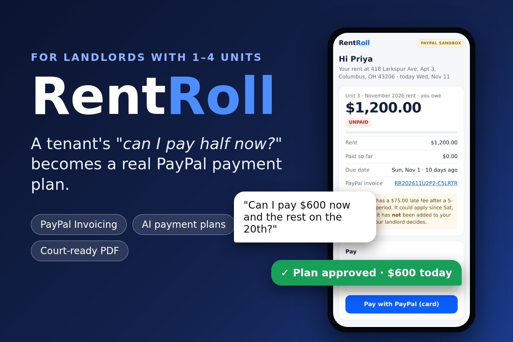
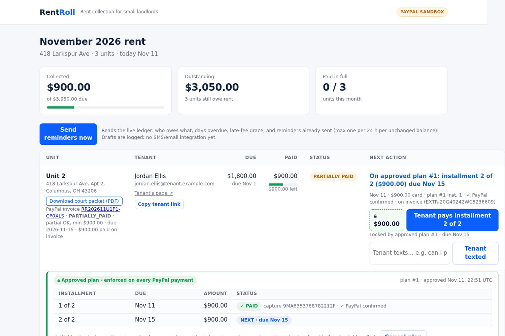
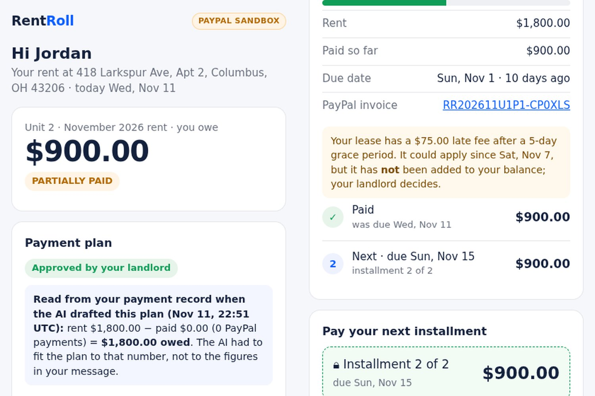
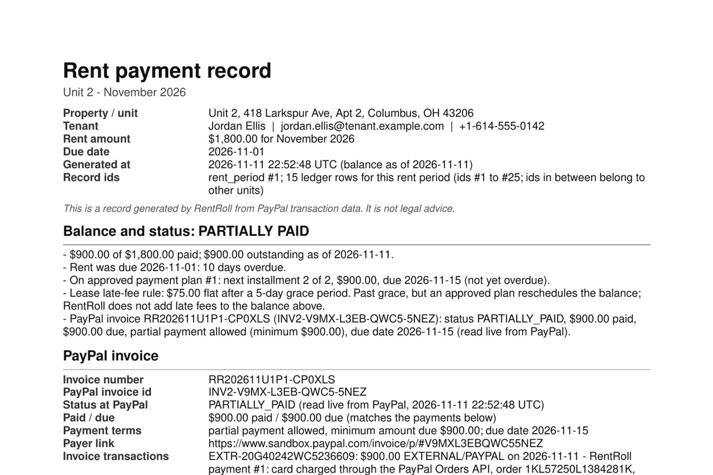

# RentRoll



🏆 Entry for the [PayPal AI Hackathon 2026](https://paypalaihackathon.devpost.com/) on Devpost · [Demo video](https://youtu.be/Eo3NTko7bwI)

Rent collection for landlords with one to four units who take rent over PayPal, Venmo or Zelle and check by hand every month who has paid.

Every month's rent is a real PayPal invoice. When a tenant writes "can I pay 900 now and the rest on the 15th", RentRoll checks what has actually been paid through PayPal and has an AI turn the message into a payment plan. Once the landlord approves it, RentRoll rewrites the PayPal invoice itself (partial payment on, minimum amount due and due date set to the next installment), and only the agreed amounts get through. Reminders are based on what's really been paid, and the whole history can be exported as a dated PDF for small claims court.

Live demo: https://nikopi5.tail4aaac7.ts.net/

It's behind a shared login so random visitors can't press the buttons before a judge does. Judges: the login is in the testing instructions of the Devpost submission. It runs against PayPal's sandbox, so no real money moves.

## What it does

- **The AI reads the ledger first.** Before it proposes anything, our code adds up the completed PayPal payments for that month and gives the model the real balance. The model works out the wording ("the rest later") and our server checks its math. In testing, a tenant who'd already paid $800 of $1,800 asked to pay "900 now and the rest later". RentRoll proposed $900 + $100. The same model without the ledger proposed $900 + $900, overcharging by $800, and our validator rejects that plan. (Details in `docs/dev-log/SPRINT2.md`.)
- **One PayPal invoice per unit per month.** RentRoll creates and sends a PayPal invoice (Invoicing API v2) for each rent period, starting as "pay in full", and stores its id and number. (`docs/dev-log/SPRINT10.md`)
- **Approving a plan changes the real invoice.** On approval RentRoll PUTs the invoice's `configuration.partial_payment` (allow partial payment, `minimum_amount_due` = the next installment) and its due date, then GETs it back to check that PayPal stored them. In the sandbox an $1,800 invoice went from "full amount, due Nov 1" to "minimum $900.00, due Nov 11". After installment 1 was paid, the due date moved to Nov 15. PayPal only enforces a minimum amount, not a schedule, so the schedule itself lives in RentRoll, and RentRoll also refuses any amount except the next installment before calling PayPal. In the sandbox, $1,800 was refused and $900 went through. (`docs/dev-log/SPRINT3.md`, `docs/dev-log/SPRINT10.md`)
- **Reminders follow the money.** Each run re-reads the payments and picks a tone: a friendly nudge inside the grace period, a firm reminder once the late fee applies, a formal notice after two weeks. If nothing changed in the last 24 hours, it skips the unit. (`docs/dev-log/SPRINT4.md`)
- **Court packet.** The "Download court packet (PDF)" link on each unit gives you a dated PDF of every message, plan, reminder and payment. It includes the PayPal invoice number, id and status (read live from PayPal when the packet is made), PayPal's order/capture ids and invoice payment ids, the webhook signature-verification result, and a SHA-256 over the included ledger rows. (`docs/dev-log/SPRINT6.md`, `docs/dev-log/SPRINT10.md`)

PayPal webhooks are signature-checked and deduplicated, and the event log is append-only. For `INVOICING.INVOICE.*` events RentRoll ignores the amounts in the payload. It GETs the invoice and reconciles every transaction on it against its own ledger. A payment recorded directly on the PayPal invoice, for example cash the landlord logged in PayPal, gets added to the ledger.

## Screenshots

<table>
<tr>
<td width="33%"></td>
<td width="33%"></td>
<td width="33%"></td>
</tr>
<tr>
<td>Landlord desktop: one real PayPal invoice per unit, an AI-proposed plan, and the installment it enforces.</td>
<td>Tenant's own phone page: no landlord login, their own message, the approved plan, the locked payment.</td>
<td>A dated, court-ready PDF with PayPal's own invoice, order and capture ids, and a webhook verification result.</td>
</tr>
</table>

## What it doesn't do yet

- Reminders are drafted and logged, not sent. There's no SMS or email integration, and you run them with the "Send reminders now" button.
- Tenant messages are typed into the dashboard. Nothing receives real texts.
- **The tenant's card is charged through Orders, not on PayPal's hosted invoice page.** "Tenant pays" charges a PayPal sandbox test card with the Orders API (no buyer login needed). RentRoll then records that capture on the invoice with Invoicing's record-payment call, and the invoice goes to PARTIALLY_PAID, then to MARKED_AS_PAID. PayPal lists these as `EXTERNAL` transactions with method `PAYPAL`, and the note on each names the Orders capture id. PayPal returns 404 if the capture id is passed as the payment id. We couldn't test whether a guest can pay the hosted invoice page with a card and no login: there was no browser in our build sandbox and we have no sandbox buyer account. If a tenant does pay there, the `INVOICING.INVOICE.PAID` webhook plus the GET adds that payment to the ledger. That path is coded, but only tested with a payment recorded directly on PayPal's side.

## Two honest weaknesses

1. **Free ACH tools exist.** Avail, TurboTenant and Zillow collect rent by bank transfer for free. RentRoll is for a narrower case: tenants who already pay through PayPal or Venmo, partial-payment deals, and a record you can take to court. The free tools do those poorly or not at all.
2. **PayPal's fee is real money.** In our sandbox runs PayPal took $25.82 on an $800 payment (2.99% + $0.49). On $1,800 rent that's about $54 a month, and closer to $60 at PayPal's 3.49% goods-and-services rate. You pay that for speed and a clean paper trail. It isn't the cheapest option.

## Run it yourself

You need Node 24 (it uses the built-in `node:sqlite`), a PayPal sandbox app and an OpenAI-compatible LLM endpoint. We used NVIDIA NIM.

Environment variables:

```
PAYPAL_CLIENT_ID
PAYPAL_CLIENT_SECRET
PAYPAL_API_BASE        # sandbox API base; the app refuses anything else
PAYPAL_WEBHOOK_ID      # id of the webhook you registered, for signature checks
NVIDIA_API_KEY
LLM_BASE_URL
LLM_MODEL              # we use nvidia/nemotron-3.5-lightning-30b-a3b
PUBLIC_BASE_URL        # public https URL PayPal can reach for webhooks
PORT                   # defaults to 8790
DEMO_USER              # shared login (/login page, signed session cookie) for every landlord page; open: /healthz,
DEMO_PASSWORD          #   /webhooks/paypal, tenant /t/<token> links. Set both on any public deployment; if unset,
                       #   the login is demo/demo (local dev only). curl/scripts may also send it as HTTP Basic Auth.
SESSION_SECRET         # optional: HMAC key for the session cookie; if unset, a random one per process start
                       #   (everyone signs in again after a restart)
```

Then:

```
npm install && ./start.sh
```

On first start it creates `data/rentroll.db` with three demo tenants and creates and sends one PayPal sandbox invoice per rent period. Your sandbox app needs the Invoicing feature enabled. `RENTROLL_INVOICING=0` turns every Invoicing call off. `node server.js --open-month 2026-12` opens the next month's rent periods and their invoices. `npm run reset` wipes it and starts over (new invoices too, with new invoice numbers).

**Resetting a running hosted demo** (e.g. before judges look at it): stop the process first — a running server keeps serving the old DB file in memory until it restarts — run `npm run reset`, then start the process again. For the systemd-managed demo that's `systemctl --user stop rentroll && npm run reset && systemctl --user start rentroll`.

For webhooks, register one at `$PUBLIC_BASE_URL/webhooks/paypal` (`node scripts/sprint0-webhook.mjs` does it) and put its id in `PAYPAL_WEBHOOK_ID`. Webhooks with a bad signature are rejected. Payments still work without them, they just won't get the "PayPal confirmed" badge.

Keep keys in env vars. `.env*` is gitignored.

## License

MIT. See `LICENSE`.
